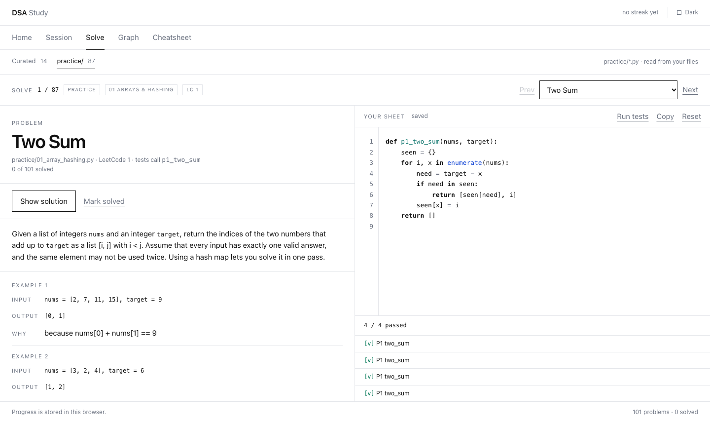
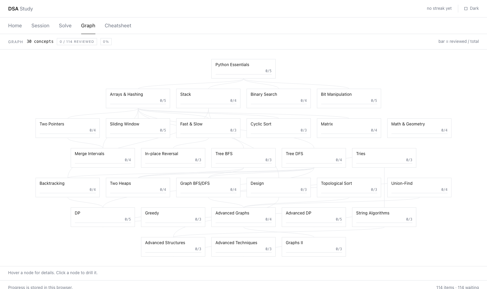

# DSA Study

A local, file-driven study app for data structures and algorithms: spaced-repetition
drills, a two-pane problem workspace, and a canvas knowledge graph.

<p align="center">
  
</p>

## What's inside

- **114 drills** across 30 patterns: recall, multiple choice, fill-in-the-blank,
  predict-output, scheduled with a small SM-2 variant.
- **101 problems** in the Solve workspace: 14 curated with solution variants plus
  **87 parsed from `practice/*.py`** (statement, examples, constraints, your code).
- **Solve**: problem and syntax-highlighted code on the left, `Show solution` with
  variants, your own sheet on the right, autosaved per problem.
- **Graph**: a canvas map of the 30 concepts with `reviewed / total` progress.
  Hover for details, click a node to start a drill session.
- Daily goal, streak, light/dark mode, export/import of progress.

<p align="center">
  
</p>

## Quick start

### Docker (one command)

```bash
REPO=AdrianTuci1/dsa-study
curl -fsSL "https://raw.githubusercontent.com/$REPO/main/run.sh" | DSA_STUDY_REPO="$REPO" bash
# open http://127.0.0.1:8765/
```

Or from a clone:

```bash
docker compose up --build
```

The workflow publishes a public image to GHCR:

```bash
docker run --rm -p 8765:8765 ghcr.io/adriantuci1/dsa-study:latest
```

The container is stateless: progress and sheets live in your browser's
`localStorage`.

### Local Python

```bash
python3 learning/study/serve.py
# open http://127.0.0.1:8765/
```

Python 3.9+, standard library only.

## Content is read from files

The server rebuilds `/api/content` on every request, so editing a source file and
reloading the page is enough. There is no build step and no content hardcoded in
JavaScript.

| File | What it holds |
|---|---|
| `learning/study_bank.py` | recall drills |
| `learning/study_extras.py` | multiple-choice, fill-in, predict-output drills |
| `learning/solve_bank.py` | curated problems with solution variants |
| `practice/*.py` | problems parsed from the practice files |
| `learning/study/graph.json` | knowledge graph nodes and edges |

Validate all sources without starting the server:

```bash
python3 learning/build_study.py
```

## Layout

```
learning/study/       app, canvas graph, API server
learning/content.py   reads and validates the sources
practice/             practice files parsed by the Solve workspace
docs/                 screenshots
```

More detail: [learning/study/README.md](learning/study/README.md).
The original DSA index (solutions, techniques, study plan) is in
[PROBLEMS.md](PROBLEMS.md).
